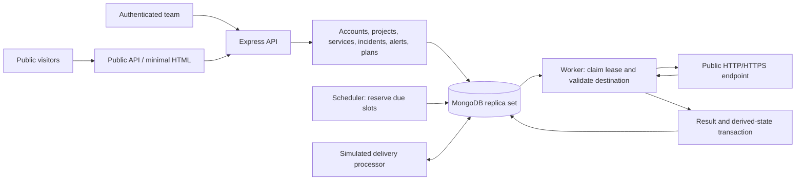
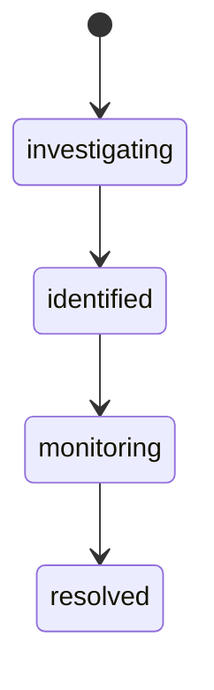

# Status Pulse — Week 1 engineering analysis

## Scope and design status

The current delivery target is weeks 1–4. [Requirements and acceptance criteria](requirements.md) define behavior and the week boundary. This analysis explains the intended v1 architecture; it does not claim that implementation, tests, or deployment are finished.

The learner's original registration story remains in the requirements document. Requirements analysis makes desired behavior and failure cases explicit before API and database choices encode assumptions.

## Architecture decision

Use **Node.js 24, TypeScript, Express 5, and the native MongoDB driver**. Keep one modular codebase with independent HTTP API and scheduler/worker processes sharing a MongoDB replica set. The replica set enables multi-document transactions for related business writes.

| Component | Purpose | Tradeoff |
| --- | --- | --- |
| Node.js 24 | Runs API and asynchronous outbound monitoring | Asynchronous execution still needs concurrency limits and race protection |
| TypeScript | Expresses inspectable request, entity, and state contracts | Static types do not validate untrusted HTTP input |
| Express 5 | Routes requests through parsing, authentication, authorization, validation, and handlers | Application structure and error contracts remain our responsibility |
| Native MongoDB driver | Exposes document storage, indexes, conditional updates, sessions, and transactions directly | Requires explicit validation/mapping instead of ORM behavior |
| MongoDB replica set | Durable data and transactions across related documents | More local setup than a standalone database |
| API process | Handles authenticated and public requests | Should not wait for the next scheduled monitoring cycle |
| Scheduler/worker process | Dispatches due slots, claims jobs, executes checks, and processes retry/delivery work | Requires durable leases, fencing, deduplication, and recovery tests |

A modular monolith keeps shared rules understandable without adding multiple service-to-service networks or deployment stacks. A separate worker entry point permits independent restarts and worker capacity while retaining one application.

A dedicated queue such as Redis-backed infrastructure is an alternative with mature queue features. PostgreSQL is another reasonable persistence choice. The selected MongoDB-backed design keeps the current stack focused; in exchange, we explicitly own job claims, leases, retries, indexes, and their tests. At larger scale, the dispatch implementation can change without replacing project permissions or incident rules.

The database-to-worker arrow represents polling/claiming durable jobs, not an automatic database push. Scheduler and worker responsibilities may share one process while remaining separate modules.

## Request and background flows

A private request follows: parse bounded input → authenticate bearer session → load project membership → authorize action → validate input → execute business operation → commit related changes → serialize a safe response. Authorization includes resource-to-project ownership; knowing a service ID is insufficient.

Monitoring follows: find eligible due service → reserve scheduled slot and create unique job → claim bounded lease → recheck current configuration/eligibility → validate and pin public destination → send timed HTTP request → commit one result, current status, history, incident/alert effects, and job completion. The network request occurs **outside** the transaction: a database transaction cannot undo an HTTP request, and slow endpoints must not hold database transactions open.

Alert processing follows: durable problem transition → deduplicated alert → simulated delivery attempt → recorded success or retryable failure → separate human acknowledgement. Delivery and acknowledgement are different facts.

Simulated payment follows: authorize owner → validate idempotency key and request identity → record failure without changing plan, or commit success plus plan activation together → return recorded outcome on replay. A later retry after failure retains failed-attempt evidence.

## Authentication and authorization

Opaque sessions make revocation and current-role checking straightforward. Generate a random bearer token, return its raw value to the caller once, and store only its hash, user ID, 24-hour expiry, and revocation state. Clients use the Authorization header; tokens must not appear in URLs or public markup. The tradeoff is a session lookup for authenticated requests.

Token hashing and password hashing solve different problems. A random session token has high entropy; a human password needs a deliberately expensive salted password-hashing function. Neither stored representation belongs in API responses.

A user can own project A, respond in B, and view C. Membership therefore belongs to a unique project/user relationship. Check current memberships per action rather than trusting client-supplied roles. Registration cannot create administrators. V1 invitations assign responder/viewer; owner transfer/removal is outside the current contract. Platform administration is separate from project ownership.

See the [role matrix](requirements.md#actors-and-permission-boundaries) for operation-level permissions.

## Incremental data model

Introduce these concepts alongside the features that need them. This is not an instruction to generate every collection before the first endpoint. Embedding versus separate documents follows query patterns, bounded growth, uniqueness needs, and transactional invariants.

| Stage / concept | Real-world meaning and important fields | Relationships, constraints, indexes |
| --- | --- | --- |
| User | Person: normalized email, name, password hash, creation time, explicit platform role if provisioned | Unique normalized email; no caller-selected administrator flag |
| Session | Login: user ID, token hash, expiry, revocation | Unique hash; user/expiry indexes; expiry checked during authentication independently of cleanup |
| Project | Team workspace: name, public identifier, current plan, creation/archive times | Unique public identifier where used; creator membership committed with project |
| Membership | User's project role: project ID, user ID, role, attribution | Unique project/user pair; user index for project lists; invitations cannot grant owner |
| Service/configuration | Monitored endpoint: project, name, URL, method, interval, timeout, expected statuses, slow/failure/recovery thresholds, public/enabled flags, revision, next due time | Due-work index; bounded validation; only owner changes configuration; archival stops dispatch |
| AuditEvent | Attributable change: actor, action, project/resource, timestamp, safe metadata | Project/time and resource/time indexes; append-only history; no secrets |
| CheckJob | Scheduled observation: service, revision, scheduled time, state, attempts, lease token/owner/expiry | Unique dispatch identity, normally service/revision/scheduled time; claimable-state/time index; conditional leases |
| CheckResult | Immutable observation: job/service, observation time, latency, outcome, HTTP status, sanitized failure | Unique job ID; service/time index; one authoritative result per job |
| Current status/counters | Latest accepted observation, consecutive successes/failures, calculated status, version | Can be embedded in Service; conditional ordering/version check prevents old results rewriting current state |
| StatusHistory | Meaningful transition: service, old/new state, reason, result, time | Service/time index; unique transition identity; retained on archival |
| Override | Temporary responder decision: state, reason, actor, start/expiry | Can be current embedded state plus audit history; enforce expiry in reads/work, not solely cleanup |
| Incident | Investigation: service/project, title, lifecycle, visibility, outage trigger, creation/resolution times | Unique automatic outage trigger where present; project/state/time index; conditional lifecycle update |
| IncidentUpdate | Narrative/state update: incident, author, visibility, body, time | Separate collection avoids unbounded embedded history; incident/time index |
| Alert | Problem notification: project/service/incident, trigger key, delivery state, acknowledgement actor/time | Unique trigger key; pending-work and project/time indexes; explicit acknowledgement |
| DeliveryAttempt | Simulated attempt: alert/subscription, channel, number, outcome/error, time | Separate attempt evidence; delivery/time index; failed history remains after success |
| Subscription | Subscriber: normalized email, project, selected public services, verification state, token hash/expiry | Unique identity such as project/email with deduplicated selections; enforce public service ownership/visibility |
| Payment operation/attempt | Simulated upgrade: project, plan, idempotency key, request fingerprint, outcome, retry linkage, activation time | Unique project/key; conflicting key reuse rejected; activation and plan update commit together |

Static plan definitions live in validated configuration. Acknowledgement is stored as bounded fields on Alert. Invitations and serviceVersions are separate collections because token acceptance and immutable configuration history need their own records. The current override is embedded in Service, with changes preserved in audit/status history. The simulatedMail collection is an owner-only demonstration inbox with automatic expiry.

Historical resources use **archive-only deletion in v1**. Archiving stops future work and public eligibility without cascading away checks, incidents, or payment evidence. All active-work queries must respect archive state. Session/verification expiry cleanup is operational housekeeping, not deletion of business history. Retention and account erasure need a deliberate future policy.

## Reliability invariants

- One service/configuration/scheduled slot creates one durable job, enforced by a unique database key.
- Only the current lease can complete a job. Reclaim changes the lease token/version; a previous owner cannot commit after replacement.
- One job creates at most one authoritative stored result. A repeated completion recognizes the existing result.
- Only a newer accepted observation advances current counters/status. Late history may be retained without rewriting the present.
- Related authoritative writes agree: result, status, history, automatic incident/alert, and job completion commit together.
- One outage/problem episode produces at most one corresponding automatic incident and alert. A separate episode can generate new records.
- Infrastructure and delivery retries are bounded and recorded. Exhaustion becomes visible failed work instead of silent success.
- One successful simulated activation applies once. Failed payment leaves the plan unchanged; conflicting reuse of a key fails.

A retry repeats an operation after uncertainty; a duplicate repeats work already received or completed. Idempotency makes repetition safe. Transactions make related database writes succeed/fail together. A lease identifies the current owner; a fencing token rejects a previous owner after replacement. These solve different parts of the same reliability problem.

A worker can crash after sending HTTP but before persisting the outcome. A later worker may send HTTP again. GET/HEAD and idempotent persistence make this manageable. The design promises one authoritative stored outcome, **not universal exactly-once network execution**.

## Status and incident policy

Defaults are three consecutive failures for outage and two consecutive successes for recovery. With no completed observation, status is unknown. Initial successful evidence remains unknown until the recovery threshold is reached. Failure before outage is degraded. Once outage is reached, retain outage until recovery succeeds; one success must not prematurely clear it. Slow responses can be degraded under the documented slow-threshold rule.

Opposite outcomes reset the corresponding consecutive counter. Older/duplicate results must not advance counters. Staleness is max(three intervals, timeout plus interval), effectively three intervals with the current bounds. Stale evidence becomes unknown even if the last completed result was healthy.

Calculated state, active override, and incident lifecycle are separate. Overrides preserve raw checks and calculated state. An expiry resumes calculated state, including unknown when stale. Recovery does not fabricate acknowledgement or automatic incident resolution.

The expected current state participates in an incident update condition. Competing or stale transition requests receive a conflict rather than overwriting newer state.

## SSRF and public information

Server-side request forgery occurs when an attacker uses the monitor's outbound capability to reach localhost, a private network, cloud metadata, or another protected destination. Valid URL syntax alone cannot prevent it.

V1 restricts protocols/methods, rejects URL credentials and custom authentication headers, validates IP literals and resolved hostname addresses, blocks private/loopback/link-local/reserved destinations including mapped forms, and pins the approved address for connection. Reject an unsafe DNS answer set rather than validating one address while the HTTP client independently resolves another. Keep HTTPS hostname/certificate verification. Disable redirects so they cannot switch to a newly unsafe destination. Bound request time and avoid retaining arbitrary response bodies. Check safety at execution as well as configuration because DNS and settings change.

Tests should inject controlled resolvers/transports or use controlled public fixtures. Do not weaken production checks to permit localhost. Production may add egress firewall controls; document controls actually deployed instead of claiming them from application validation.

Public serializers explicitly choose allowed fields. Removing a few known secrets from a whole private document is fragile as fields evolve. Public incident output must respect service visibility and update visibility. Subscriptions cannot select private IDs by guessing them. Any HTML page must escape user-controlled service names and incident text.

## API design principles

Private routes require authentication and scoped authorization. Public routes use explicit safe projections. Resource groups are accounts/sessions, projects/memberships, services/checks/status, incidents/updates, alerts/acknowledgements, public status/subscriptions, simulated payment, and administration/audit.

Each endpoint documents method/path, request, authentication, role, validation, response, expected errors, and database effects. Use 201 for creation, 200 for reads/returned mutations, 204 when success has no body, 401 for invalid/missing authentication, 403 for insufficient permission when existence may be known, 404 for absent/inaccessible resources where appropriate, 409 for duplicates/conflicting transitions or idempotency misuse, and a consistent validation status. Unexpected failures return sanitized 500 responses.

Exact paths and schemas belong in the evolving OpenAPI/Postman or API contract artifact. Distinguish HTTP request failures from background job failures and explicitly identify simulated operations.

## Verification and coursework evidence

For each major feature: implement → manually exercise → add appropriate automated tests → run them → inspect/fix failures → record evidence. Tests assert business outcomes and invariants rather than merely mirroring internal branches.

Unit tests cover deterministic validation, thresholds, and lifecycle rules. Integration tests against a MongoDB replica set cover uniqueness, transactions, authorization, claims, retries, and payment activation. Mocked database calls cannot prove real concurrency/transaction behavior. Controlled transports simulate timeout, connection failure, HTTP 500, slow response, success, and unsafe DNS without relying on unstable external services.

By week 4, evidence should cover all seven integrated acceptance scenarios in [requirements.md](requirements.md#integrated-acceptance-scenarios), along with documented limitations. Shared/test deployment evidence checks API readiness, indexes/database connectivity, worker dispatch/completion, privacy, and simulated workflows. Preparing a deployment checklist is not proof of deployment.

Weeks 5–6 reserve broader regression/failure review, hardening, documentation polish, final demo, and presentation practice. Deferral does not excuse missing authentication, private-data protection, transactions, duplicate prevention, or feature tests in weeks 1–4.
