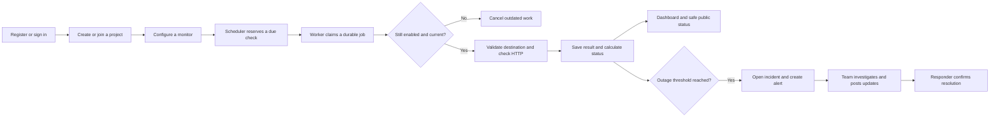
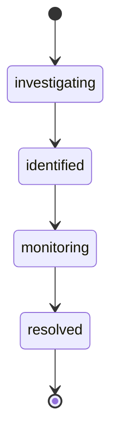
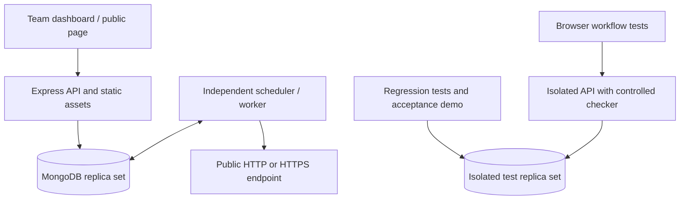

# How Status Pulse works

Status Pulse gives a team one place to monitor services, respond to incidents, and keep people informed. The dashboard is the everyday workspace. The API applies the rules behind each action, while a separate worker keeps checking endpoints even when nobody has the dashboard open.

## From a new account to a monitored service

Create an account, then create a project for a product or group of related services. You become its owner. Add a monitor with a public HTTP or HTTPS address, the expected status range, and a check interval. You can also set how many failures count as an outage and how many successful checks are needed for recovery.

A new monitor starts as **unknown**. Status Pulse waits for evidence instead of displaying a healthy status before a check has happened. The worker records the HTTP response, latency, and any failure. The dashboard turns those records into service status, a recent-check strip, and a response-time chart.

The scheduler and workers use database constraints and short leases to coordinate. Two workers cannot commit two authoritative results for the same job. If a worker disappears, another can reclaim eligible work. Repeated internal failures eventually stop retrying and become operational evidence. An HTTP request can still be repeated after a crash; the guarantee concerns the stored result, not universal exactly-once network execution.

## Understanding the status

| Status | What it tells you |
| --- | --- |
| Unknown | There is not enough recent evidence, or monitoring is disabled |
| Operational | Successful checks have reached the configured recovery threshold and are within the response-time threshold |
| Degraded | Early failures or sufficiently slow successful responses need attention |
| Outage | The configured consecutive-failure threshold has been reached |
| Paused in the dashboard | The monitor is disabled; it is not proof of availability |

By default, an outage needs three consecutive failed checks and recovery needs two successful checks. A service stays in outage during partial recovery. Results older than three configured intervals no longer establish current availability. A temporary override changes the displayed status, keeps the calculated evidence intact, and expires automatically.

Open a monitor's details to inspect the latest results and status history. Owners can edit its configuration and review earlier versions. Archiving stops future work and removes public visibility while keeping historical records. A request already in flight cannot be recalled; completion checks prevent it from incorrectly advancing a changed monitor.

## Responding to an incident

An outage can create an incident automatically. Owners and responders can also report one themselves. There is at most one active incident per service. Each update records a message, visibility, author, time, and lifecycle state.

Updates can remain in the current state while the team gathers information, but they cannot skip or reverse the sequence. A successful monitoring recovery records evidence; a person still decides when the incident is resolved. Revision checks reject stale edits so one teammate cannot silently overwrite another's update.

Alerts keep two separate facts: whether simulated delivery succeeded and whether a responder acknowledged the alert. Delivery can fail without losing the alert. Automatic attempts are bounded; an owner or responder can retry explicitly. Acknowledgement means someone has taken responsibility, and does not claim that the email arrived or the incident is resolved.

## Keeping users informed

Enable public visibility for the project and the monitors you want to share. Visitors open `/status/PROJECT-SLUG` without signing in. They see public service names, statuses, timestamps, incident updates, and status history. Endpoint URLs, internal notes, memberships, and private configuration stay behind the authenticated API.

A visitor selects services, submits an email address, and completes the simulated verification step. In development, a new verification code can be filled into the public form. In production, the owner retrieves it from the protected simulated inbox. Verification expires after 24 hours and can be used once. Public updates produce deduplicated notification records only for verified subscribers whose selected services remain public.

No real email is sent and this flow does not prove mailbox ownership. The public page says so explicitly. It refreshes every 30 seconds when visible and not interrupting the subscription form. Timestamps are shown in the visitor's local timezone.

## Working as a team

Owners invite teammates as responders or viewers, share the simulated invitation code, and manage their access from Team. The invitee must sign in with the invited email address before accepting the code. Owners control configuration and plans; responders handle operational actions; viewers inspect information. The server checks each action even if someone bypasses the visible controls.

Platform administrators are provisioned with the operator command in the README. Their Operations view shows worker heartbeats, failed jobs, delivery failures, and audit events. Administration does not automatically grant access to a project's private data.

## Trying the advanced plan

Open Project settings and explore the advanced plan. A successful simulated payment enables 30-second check intervals. A failed payment leaves the current plan unchanged. Payment history lets you retry the same request, using the same idempotency key; repeated success cannot activate the plan twice. There is no card collection or real charge.

## Running and reviewing the whole system

Run `npm run local` for day-to-day use. Run `npm run verify` for the regression suite, browser workflows, build, and deterministic demo. Test data is isolated from the persistent development database. The [final delivery report](final-delivery.md) records the results and gives a presentation sequence; the [deployment guide](deployment.md) explains the separate hosted verification step.
